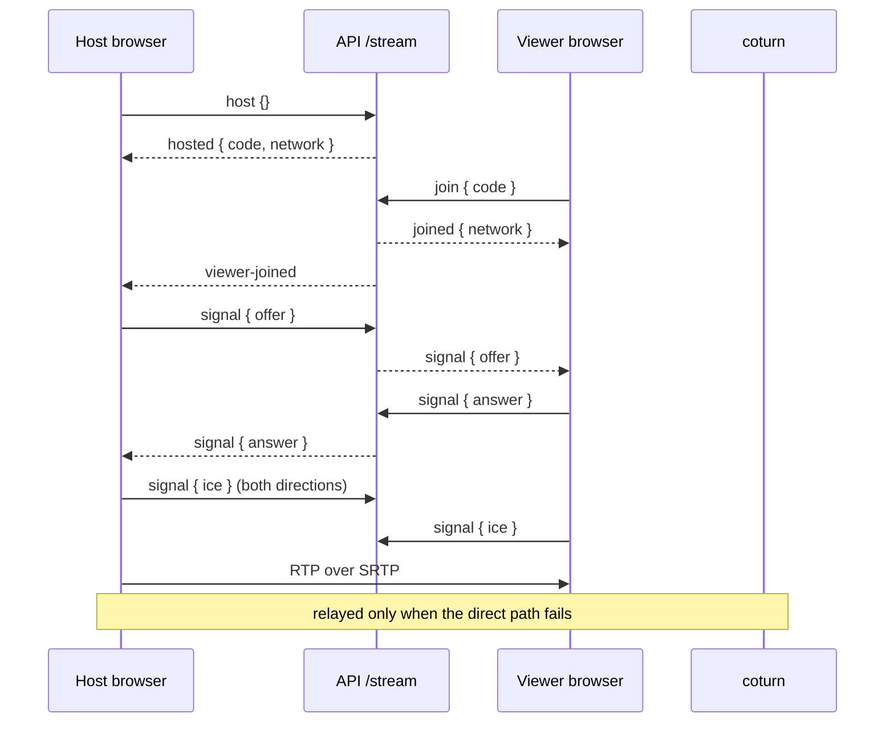

# MoonStream

MoonStream shares one admin's screen with another admin's browser. The host opens
`/admin/stream`, gets a six-character code, and picks a screen, a window or a tab. The viewer opens
`/admin/stream/watch/<code>` (or `/admin/stream/watch` and types the code), enters it and watches.

There is no agent to install and no media server in the middle: the browsers exchange SDP and ICE
over the API's `/stream` Socket.IO namespace, then send RTP directly. When a direct path is
impossible, the existing MoonCellar coturn relay carries the session.

## Access

- The pages live under `/admin`, so `apps/web/src/app/admin/layout.tsx` gates them on the server
  with `GET /admin/access`; everyone else gets a 404.
- The `/stream` namespace repeats the check on the handshake, as `/conflicts` does: the
  `accessMoonToken` cookie must verify, the account must exist and its `roles` must include
  `admin`. A missing or expired token
  gets `Unauthorized`; a valid non-admin gets `Forbidden`. Both pages then show the message
  instead of a stream.
- When only a refresh cookie is left, the stream hooks call the shared `refreshAuth()`, which is
  deduplicated so the page layout and the socket cannot rotate the same refresh token twice.
- The handshake also rejects an `Origin` the API does not serve (`getCorsOrigins()`). CORS covers
  polling but not the WebSocket upgrade, so this is what stops a foreign page from opening the
  namespace with the session cookie.

Widening access later means changing these two checks, not the media path. There is no per-room
permission model yet: an admin with the code can watch, so a host shares the code deliberately.

## Flow



The host creates the room before it captures anything. `viewer-joined` only flips a flag; the
offer is created when both a viewer and a source exist. That is why a viewer can join while the
host is still choosing a screen.

| Client event                | Ack / server event                                      | What happens                                                                           |
| --------------------------- | ------------------------------------------------------- | -------------------------------------------------------------------------------------- |
| `stream:host`               | `ok { code, network, expiresAt }`                       | Starts a room; a host already in one leaves it first.                                  |
| `stream:join { code }`      | `ok { network }`; host gets `stream:viewer-joined`      | Connects the one viewer slot.                                                          |
| `stream:signal { payload }` | `ok`                                                    | Relays an offer, an answer or an ICE candidate to the other side.                      |
| `stream:kick`               | `ok`; viewer gets `stream:closed { reason: "removed" }` | Frees the viewer slot; the room stays.                                                 |
| `stream:stop`               | `ok`; viewer gets `closed { reason: "host-stopped" }`   | Ends the room.                                                                         |
| `stream:leave`              | —                                                       | A viewer leaves; the host gets `stream:viewer-left`. The host leaving closes the room. |

Reasons on `stream:closed`: `host-left`, `host-stopped`, `removed`, `idle`. The contract lives in
`packages/schemas/src/stream.schema.ts`, and the gateway validates every payload itself because
Nest's global pipe does not run for sockets.

## TURN

`StreamService` signs coturn REST credentials with `TURN_SECRET`, the same field the game service
uses. The username is `<expiry>:<room code>` and the credential is base64 HMAC-SHA1 of it; the
default lifetime is twelve hours. The deploy appends `TURN_SECRET` and
`TURN_URLS=game.mooncellar.space:3478` to `apps/api/.env`, and
`apps/api/src/module/stream/stream-turn.ts` turns the scheme-less URL into
`turn:game.mooncellar.space:3478?transport=udp` for `RTCPeerConnection`. STUN is derived from the
same host when `STUN_URLS` is empty. The relay runs with `--no-tcp-relay` and `--no-tls`, so a
network that blocks UDP has no relayed path; direct candidates and STUN still work where they can.

The relay in `infra/docker-compose.prod.yml` caps a session at `--max-bps=262144` (about
2 Mbit/s), which is fine for a screen at 720p but not for sharp 1080p. MoonStream exposes a
"Relay safe" preset at 1.6 Mbit/s and shows whether the selected candidate pair is `relay`. Raise
`--max-bps` on the relay before making higher presets the default for relayed sessions; the cap is
per session, so a larger value costs bandwidth, not correctness.

## Capture

The host capture is `navigator.mediaDevices.getDisplayMedia`, called from the "Share a screen"
click. The browser shows the operating system's picker; MoonStream never enumerates sources.

| Platform       | Picker and capture path                                                             |
| -------------- | ----------------------------------------------------------------------------------- |
| Linux, Wayland | PipeWire through `xdg-desktop-portal` (GNOME/KDE portal, `pipewire`, `wireplumber`) |
| Linux, X11     | The browser captures the X11 screen or window directly                              |
| Windows        | Windows Graphics Capture in current Chrome/Edge, DXGI in older ones                 |
| macOS          | ScreenCaptureKit through the system screen-recording permission                     |

`getDisplayMedia` requires a secure context: `https://mooncellar.space` in production and
`http://localhost` in development. An `http://192.168.x.x` origin cannot capture. Audio is
requested with `audio: true`; whether the picker offers system audio, a tab's audio or nothing is
the platform's decision, so the host page reports `audioShared` and disables the mute control when
there is no audio track.

The capture is capped at 1920×1080 and 60 fps in the media constraints. Quality presets then set
`maxBitrate`, `maxFramerate`, `contentHint` and `degradationPreference` on the video sender:
Sharp (8 Mbit/s, resolution first), Balanced (3 Mbit/s, the default), Smooth (6 Mbit/s, frame rate
first) and Relay safe (1.6 Mbit/s). Changing the preset is live; changing the source replaces the
tracks on the existing senders, so no renegotiation is needed.

## Limits

- One viewer per room. A room lives while its host tab is open and two hours without activity.
- Rooms and codes are in API memory. The API is deployed as one container; a second instance would
  not see the first one's rooms, so keep the feature on one instance until a shared store exists.
- The host must keep the tab open; the browser may throttle background tabs and the capture stops
  when the host presses "Stop sharing". Both cases end the room with a message.
- There is no remote control, clipboard, file transfer or audio from the viewer's microphone.
- The viewer receives whatever the host shares, including notifications. The host should pick a
  window or a tab rather than the whole desktop when that matters.

## Deployment

No nginx change is needed: `api.mooncellar.space` already upgrades `/socket.io/` to WebSocket, and
the `/stream` namespace uses the same path. The API image and the `HOST_ENV_API` secret are enough.

1. Append the TURN values to `HOST_ENV_API` by hand if the deploy's `TURN_SECRET` is not set:
   `TURN_SECRET=<the same secret as the relay>` and `TURN_URLS=game.mooncellar.space:3478`. The
   workflow does the same automatically when the repository secret exists.
2. Deploy the API (`gh workflow run ci.yml --ref main` with the `api` path changed). `bun --filter
api build` runs the typecheck and the boot check, which catches a missing provider.
3. Sign in as an admin and open `https://mooncellar.space/admin/stream`.
4. On a second computer, open the viewer link from the host page. Both computers need a browser
   with WebRTC; both accounts need the admin role.

## Tests

```bash
bun --filter api test src/module/stream
bun --filter api typecheck
bun --filter web lint
bun --filter web build
```

`stream.service.spec.ts` covers room transitions and the idle timer, `stream-turn.spec.ts` covers
the credential and URL shapes, and `stream.gateway.spec.ts` boots the real gateway on an
`IoAdapter` and checks the missing-cookie, non-admin, host/viewer, signal and stop paths.

## Related

- [Sockets](sockets.md) — how the namespace sits next to the other real-time channels.
- [Game service](game-service.md#turn-relay) — the relay and the same credential scheme.
- [Deployment variables](deploy-env.md#host_env_api-contents) — where `TURN_SECRET` lives.
