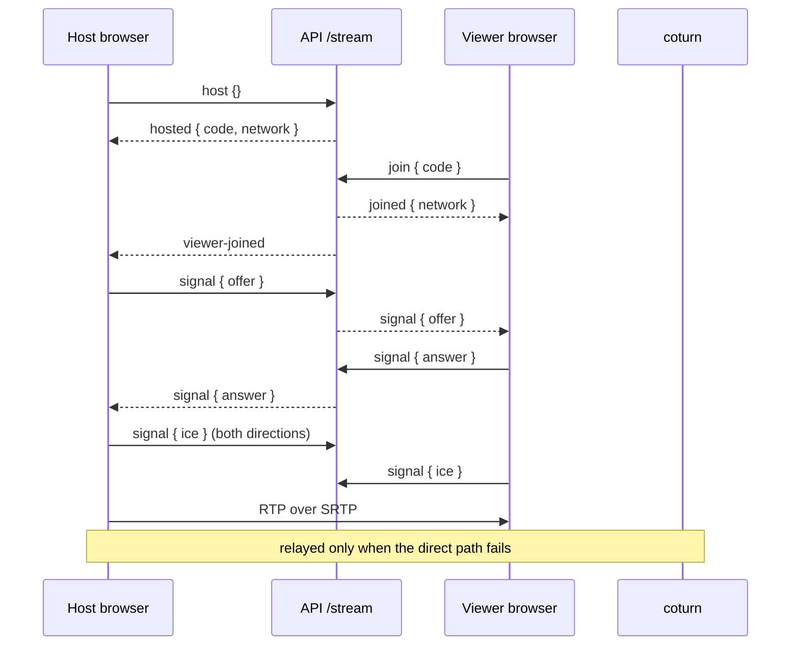

# MoonStream

MoonStream shares one admin's screen with another admin's browser. The host opens
`/admin/stream`, gets a six-character code, and picks a screen, a window or a tab. The viewer opens
`/admin/stream/watch/<code>` (or `/admin/stream/watch` and types the code), enters it and watches.

The invite panel carries both ways to use the link: **Copy link** copies the absolute
`FRONT_URL` URL to send to the other admin, and **Open viewer** opens the same page in a **new
tab** at `/admin/stream/watch/<code>`. The new tab is not cosmetic — leaving the host page ends
the room (`stream:leave`), so a same-tab navigation would close the stream the host is about to
watch. Opening the page only prefills the code; joining is still a click of "Watch stream" there,
and that click takes the room's single viewer slot. The design alternatives are recorded in
[`docs/mockups/stream-viewer-entry.html`](mockups/stream-viewer-entry.html).

An admin who was given a code rather than a link reaches the form through **Watch a stream** in the
host page header. It opens `/admin/stream/watch` with no code in a new tab: the invite panel's link
only exists once this host has a room, and a same-tab navigation away from `/admin/stream` would end
that room.

There is no agent to install and no media server in the middle: the browsers exchange SDP and ICE
over the API's `/stream` Socket.IO namespace, then send RTP directly. When a direct path is
impossible, the existing MoonCellar coturn relay carries the session.

## Access

- The pages live under `/admin`, so `apps/web/src/app/admin/layout.tsx` gates them on the server
  with `GET /admin/access`; everyone else gets a 404.
- The `/stream` namespace repeats the check on the handshake, as `/conflicts` does: the
  `accessMoonToken` cookie must verify, the account must exist and its `roles` must include
  `admin`. A missing or expired token
  gets `Unauthorized`; a valid non-admin gets `Forbidden`. Both pages then show the message
  instead of a stream.
- When only a refresh cookie is left, the stream hooks call the shared `refreshAuth()`, which is
  deduplicated so the page layout and the socket cannot rotate the same refresh token twice.
- The handshake also rejects an `Origin` the API does not serve (`getCorsOrigins()`). CORS covers
  polling but not the WebSocket upgrade, so this is what stops a foreign page from opening the
  namespace with the session cookie.

Widening access later means changing these two checks, not the media path. There is no per-room
permission model yet: an admin with the code can watch, so a host shares the code deliberately.

## Flow



The host creates the room before it captures anything. `viewer-joined` only flips a flag; the
offer is created when both a viewer and a source exist. That is why a viewer can join while the
host is still choosing a screen.

| Client event                | Ack / server event                                      | What happens                                                                           |
| --------------------------- | ------------------------------------------------------- | -------------------------------------------------------------------------------------- |
| `stream:host`               | `ok { code, network, expiresAt }`                       | Starts a room; a host already in one leaves it first.                                  |
| `stream:join { code }`      | `ok { network }`; host gets `stream:viewer-joined`      | Connects the one viewer slot.                                                          |
| `stream:signal { payload }` | `ok`                                                    | Relays an offer, an answer or an ICE candidate to the other side.                      |
| `stream:kick`               | `ok`; viewer gets `stream:closed { reason: "removed" }` | Frees the viewer slot; the room stays.                                                 |
| `stream:stop`               | `ok`; viewer gets `closed { reason: "host-stopped" }`   | Ends the room.                                                                         |
| `stream:leave`              | —                                                       | A viewer leaves; the host gets `stream:viewer-left`. The host leaving closes the room. |

Reasons on `stream:closed`: `host-left`, `host-stopped`, `removed`, `idle`. The contract lives in
`packages/schemas/src/stream.schema.ts`, and the gateway validates every payload itself because
Nest's global pipe does not run for sockets.

## TURN

`StreamService` signs coturn REST credentials with `TURN_SECRET`, the same field the game service
uses. The username is `<expiry>:<room code>` and the credential is base64 HMAC-SHA1 of it; the
default lifetime is twelve hours. The deploy appends `TURN_SECRET` and
`TURN_URLS=game.mooncellar.space:3478` to `apps/api/.env`, and
`apps/api/src/module/stream/stream-turn.ts` turns the scheme-less URL into
`turn:game.mooncellar.space:3478?transport=udp` for `RTCPeerConnection`. STUN is derived from the
same host when `STUN_URLS` is empty. The relay runs with `--no-tcp-relay` and `--no-tls`, so a
network that blocks UDP has no relayed path; direct candidates and STUN still work where they can.

The relay in `infra/docker-compose.prod.yml` caps a session at `--max-bps=262144` (about
2 Mbit/s), which is fine for a screen at 720p but not for sharp 1080p. MoonStream exposes a
"Relay safe" preset at 1.6 Mbit/s and shows whether the selected candidate pair is `relay`. Raise
`--max-bps` on the relay before making higher presets the default for relayed sessions; the cap is
per session, so a larger value costs bandwidth, not correctness.

## Capture

The host capture is `navigator.mediaDevices.getDisplayMedia`, called from the "Share a screen"
click. The browser shows the operating system's picker; MoonStream never enumerates sources.

| Platform       | Picker and capture path                                                             |
| -------------- | ----------------------------------------------------------------------------------- |
| Linux, Wayland | PipeWire through `xdg-desktop-portal` (GNOME/KDE portal, `pipewire`, `wireplumber`) |
| Linux, X11     | The browser captures the X11 screen or window directly                              |
| Windows        | Windows Graphics Capture in current Chrome/Edge, DXGI in older ones                 |
| macOS          | ScreenCaptureKit through the system screen-recording permission                     |

`getDisplayMedia` requires a secure context: `https://mooncellar.space` in production and
`http://localhost` in development. An `http://192.168.x.x` origin cannot capture.

### Audio

Sound is the platform's decision, not MoonStream's. The capture always asks for it, and the picker
decides what it can deliver:

| Platform          | What the capture can carry                                                                 |
| ----------------- | ------------------------------------------------------------------------------------------ |
| Windows, ChromeOS | The whole system's audio when a screen is shared                                           |
| Linux, macOS      | Only a browser tab's audio: share the tab and turn on "Also share tab audio" in the picker |
| Firefox, Safari   | Nothing; their `getDisplayMedia` never returns an audio track                              |

The Linux rule belongs to Chromium, not to a brand: Helium, Chrome, Edge and Brave all capture the
screen through PipeWire (Wayland) or X11 without desktop audio, because Chromium implements
system-audio capture only on Windows and ChromeOS ([compat note](https://github.com/mdn/browser-compat-data/blob/main/api/MediaDevices.json)).
Sharing a screen or a window on Linux therefore always ends with `audioShared === false`: the
"Audio off" toggle stays disabled and the panel explains how to include sound instead.

`capturePlatformNote()` (`features/stream/model/capture.ts`) owns that copy. `audioLabel` is the
checkbox label — it says "system audio" only where there is system audio — and `audioNote` explains
the tab workaround where there is none. Keep the platform promises there, not in the widget. The
host page still reports `audioShared` from the returned stream and disables the mute control when
there is no audio track.

### Sound from an input

Where the capture carries no audio — every screen share on Linux and macOS — the host can attach an
input instead. **Sound** is a plain list of the `audioinput` devices — no extra button — and the
chosen one is sent through the same audio transceiver; **Shared screen audio** switches back when
the capture has its own. The page asks for microphone access the first time the list is opened,
and fills the list on load when the permission is already granted.

The input can be chosen before anything is shared: the track waits on its own, `capture()` moves it
into the new stream, and a re-share keeps it — the track is taken out of the old stream before that
stream is stopped, so the same microphone is not closed and reopened. `stopLocal()` stops it
explicitly, because it may not belong to any stream yet; the mute toggle stays disabled until a
stream is live. `audioTrackRef` in `useStreamHost` decides which track is sent, since one stream can
hold both the screen's audio and a device's.

The input can also be switched **while a viewer is watching**: the new track is `replaceTrack`d onto
the existing audio sender, so nothing renegotiates and the viewer keeps the same audio track — only
its content changes. That is why the list stays enabled during a stream.

**No sound**, the first item of the list, is how the host stops sharing sound: it drops the device
track, sends `replaceTrack(null)` and leaves the stream video-only. It is not the same as the mute
toggle, which keeps the track and only disables it.

#### Linux: a virtual input

Chromium deliberately hides PulseAudio/PipeWire **monitor** sources from that list
(`media/audio/pulse/audio_manager_pulse.cc` skips every source whose `monitor_of_sink` is set), so
"Monitor of …" never appears as a microphone. Route the output through a virtual source instead —
everything that plays into the speakers then goes out with the stream:

```bash
pactl load-module module-remap-source \
  master="$(pactl get-default-sink).monitor" \
  source_name=desktop_audio \
  source_properties=device.description=DesktopAudio
```

Only **sources** reach the picker: a sink — an output such as `easyeffects_sink`, a game, the
speakers — cannot be captured directly, only its `.monitor` can, and Chromium hides every monitor.
EasyEffects publishes a real source of its own, `easyeffects_source` ("Easy Effects Source"), so it
is listed; it carries what plays into `easyeffects_sink`, and only while EasyEffects runs. A monitor
that is not published as a source can be given a normal name the same way:

```bash
pactl load-module module-remap-source master=easyeffects_sink.monitor \
  source_name=ee_desktop source_properties=device.description=EE-Desktop
```

The module does not survive a logout. Make it a PipeWire drop-in instead of a startup script —
`~/.config/pipewire/pipewire-pulse.conf.d/10-moonstream-audio.conf`:

```conf
pulse.cmd = [
  {
    cmd = "load-module"
    args = "module-remap-source master=easyeffects_sink.monitor source_name=ee_desktop source_properties=device.description=EE-Desktop"
  }
]
```

It applies on `systemctl --user restart pipewire-pulse` or the next login. The source is created
even before `easyeffects_sink` exists and links itself once EasyEffects starts, so nothing depends
on which of the two comes up first.

To remove a source again: `pactl unload-module <id>` with the id from
`pactl list short modules | grep remap` (`pactl unload-module module-remap-source` drops every
remap at once). A drop-in is removed by deleting its file and restarting `pipewire-pulse`; a module
loaded twice under the same `source_name` shows up as `EE-Desktop` and `EE-Desktop-2`, and both
have to be unloaded.

That source carries **everything**, including a Discord call and every notification:

- a viewer who is himself in the call hears his own voice back with the stream's delay;
- a third viewer in the same call hears every voice twice — once from Discord, once from the stream;
- whatever else plays, a private call or a notification sound, reaches the viewer;
- the host's own viewer tab ("Open viewer"), once it plays the stream with sound, is captured too
  and the stream feeds itself — mute that tab while the monitor is the input.

To share only what should be heard, give MoonStream its own output and move just that application
into it, leaving the call on the normal output:

```bash
# a second output nothing plays into by default
pactl load-module module-null-sink sink_name=moonstream_mix \
  sink_properties=device.description=MoonStreamMix

# so the host still hears what it carries
pactl load-module module-loopback source=moonstream_mix.monitor \
  sink=@DEFAULT_SINK@ latency_msec=1

# the input MoonStream lists — a remap, not a monitor
pactl load-module module-remap-source master=moonstream_mix.monitor \
  source_name=moonstream_audio \
  source_properties=device.description=MoonStreamAudio

# the game or the player goes there; the index comes from `pactl list short sink-inputs`
pactl move-sink-input <INDEX> moonstream_mix
```

Discord stays on the default output and never reaches the stream; `pavucontrol` does the same move
with the mouse. `move-sink-input` is not persistent — an application that reopens its audio stream
(a restart, a new call) starts on the default output again. The panel's "How to create a virtual
input" link points here.

## Limits

- One viewer per room. A room lives while its host tab is open and two hours without activity.
- Rooms and codes are in API memory. The API is deployed as one container; a second instance would
  not see the first one's rooms, so keep the feature on one instance until a shared store exists.
- The host must keep the tab open; the browser may throttle background tabs and the capture stops
  when the host presses "Stop sharing". Both cases end the room with a message.
- There is no remote control, clipboard, file transfer or audio from the viewer's microphone.
- The viewer receives whatever the host shares, including notifications. The host should pick a
  window or a tab rather than the whole desktop when that matters.

## Deployment

No nginx change is needed: `api.mooncellar.space` already upgrades `/socket.io/` to WebSocket, and
the `/stream` namespace uses the same path. The API image and the `HOST_ENV_API` secret are enough.

1. Append the TURN values to `HOST_ENV_API` by hand if the deploy's `TURN_SECRET` is not set:
   `TURN_SECRET=<the same secret as the relay>` and `TURN_URLS=game.mooncellar.space:3478`. The
   workflow does the same automatically when the repository secret exists.
2. Deploy the API (`gh workflow run ci.yml --ref main` with the `api` path changed). `bun --filter
api build` runs the typecheck and the boot check, which catches a missing provider.
3. Sign in as an admin and open `https://mooncellar.space/admin/stream`.
4. On a second computer, open the viewer link from the host page. Both computers need a browser
   with WebRTC; both accounts need the admin role.

## Tests

```bash
bun --filter api test src/module/stream
bun --filter api typecheck
bun --filter web lint
bun --filter web build
```

`stream.service.spec.ts` covers room transitions and the idle timer, `stream-turn.spec.ts` covers
the credential and URL shapes, and `stream.gateway.spec.ts` boots the real gateway on an
`IoAdapter` and checks the missing-cookie, non-admin, host/viewer, signal and stop paths.

## Related

- [Sockets](sockets.md) — how the namespace sits next to the other real-time channels.
- [Game service](game-service.md#turn-relay) — the relay and the same credential scheme.
- [Deployment variables](deploy-env.md#host_env_api-contents) — where `TURN_SECRET` lives.
